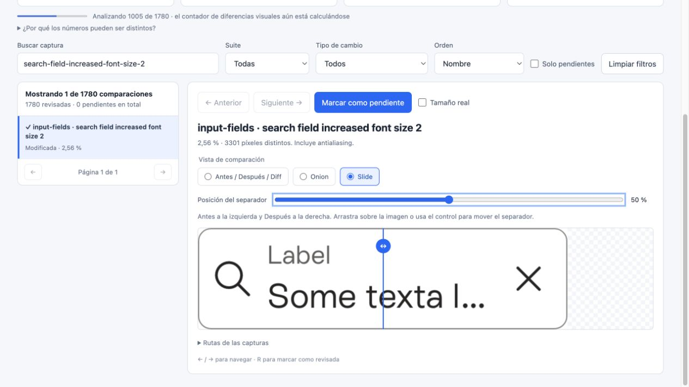

# Git Snapshot Reviewer

Review PNG snapshot changes between two Git revisions in a local browser. Works with **mistica-web**, **webapp** and other repositories using Jest image snapshots or Playwright PNG references.

Choose between **Before / After / Diff**, **Onion** with adjustable opacity, and **Slide** with a draggable divider. Filter images, inspect them at actual size and mark them as reviewed as you go.



## Start

Requires Git, Node.js 20 or later, and Yarn 3.6.1. If Yarn is not managed by Corepack yet, run `corepack enable` first. You can also use `corepack yarn` in place of `yarn` below without changing the global Yarn installation.

Clone this tool beside the repositories you want to review:

```sh
git clone https://github.com/AlexandraGallipoliRodrigues/git-snapshot-reviewer.git
cd git-snapshot-reviewer
yarn install --immutable
```

To review Mística:

```sh
git -C ../mistica-web fetch origin
yarn start --repo ../mistica-web
```

To review webapp:

```sh
git -C ../webapp fetch origin
yarn start --repo ../webapp
```

Open the URL printed in the terminal, choose the base and changed branches, and click **Comparar capturas**. Use the `origin/...` references to review the latest fetched commits; a local branch may still point to an older commit.

You can preselect the revisions and an optional fixed port:

```sh
yarn start --repo ../mistica-web --base origin/master --head origin/update-snapshots
yarn start --repo /path/to/webapp --base origin/master --head origin/my-branch --port 4321
```

`--repo` can point to any local Git clone, including a worktree. Without it, the current directory is used. The tool uses its own dependencies, so the target repository does not need a particular test runner, Node version or installed packages. It reads committed PNGs from Git without checking out either compared branch or generating snapshots.

By default, the comparison starts at the common ancestor, like a pull request. Choose **Comparar las dos versiones directamente** under comparison options to compare the selected revisions themselves. Local branches, remote-tracking branches, tags and commit SHAs are supported. Run `git fetch` yourself when you want newer remote revisions; **Actualizar lista** only refreshes the branch names already in your clone.

## Review images

-   **Antes / Después / Diff** shows both versions and highlights different pixels in red, including antialiasing changes.
-   **Onion** overlays the updated image with adjustable opacity: 0% shows the original, 100% the update.
-   **Slide** reveals the update to the right of a divider. Drag over the image or adjust the slider with the mouse or keyboard.
-   Both overlay views align images at their top-left corner without stretching either one when dimensions differ. Additions and deletions use the side-by-side view because one side is missing.
-   Search by component, test name or path; filter by suite, change type or **Solo pendientes**.
-   Use **Tamaño real** to inspect without resizing. Arrow keys navigate captures; **R** toggles the reviewed mark while focus is outside the form controls.

The tool recognizes PNGs in `__image_snapshots__`, `__playwright_snapshots__` and Playwright's default `*-snapshots` directories, at any depth. Existing file and folder paths are preserved. Renames are paired when the match is unambiguous; ambiguous additions and deletions stay separate so no changed file silently disappears.

## Your progress

Review marks are saved inside the target repository's Git metadata, under `screenshot-review/reviews.json` in its common Git directory. The target working tree stays clean, and worktrees of the same repository share progress. Different clones keep their own progress.

Repeating a comparison or changing branch commits preserves the marks for image pairs whose contents and paths have not changed. Updated or renamed pairs become pending again. The state is local and is not committed or uploaded to GitHub.

If you used the earlier Mística script, the tool automatically reads its existing `reports/screenshot-review/reviews.json` when no new state exists yet. The next review mark saves that progress in the Git metadata. The original file is left intact. Stop the earlier viewer when moving to this version so you continue reviewing in one place.

## Understand the counts

-   **Cambios de archivos PNG en Git**: snapshot file changes according to Git's rename detection.
-   **Comparaciones de capturas**: before/after pairs; an addition and deletion can form one renamed capture.
-   **Con diferencias de píxeles**: pairs whose decoded pixels differ. This fills in during background analysis; a differently encoded PNG can have identical pixels.
-   **Pendientes de revisar**: unreviewed pairs across the whole comparison.
-   **Mostrando X de Y**: filtered results out of all comparisons.
-   **Página X de Y**: pages of up to 25 captures, not an image count.

Non-image file changes are counted separately under **¿Por qué los números pueden ser distintos?**. Undecodable PNGs are shown as errors rather than omitted.

## Share with your team

Share this repository. Each person runs the tool against their own clone. The server listens only on `127.0.0.1`, uses no GitHub token and keeps the images on the local computer. A localhost URL is only accessible on the computer running it.

## Development

```sh
yarn test
yarn format:check
```

The tests cover Git comparisons, nested monorepo paths, renamed images, pixel differences, dimensions, HTTP endpoints and review persistence, including progress from the earlier Mística viewer.

The PNG decoder is the only runtime dependency. The UI is plain HTML, CSS and JavaScript; there is no build step.

## License and origin

MIT. Extracted from the screenshot-review tool originally proposed in [mistica-web #1818](https://github.com/Telefonica/mistica-web/pull/1818), keeping the original MIT notice in [LICENSE](LICENSE).
